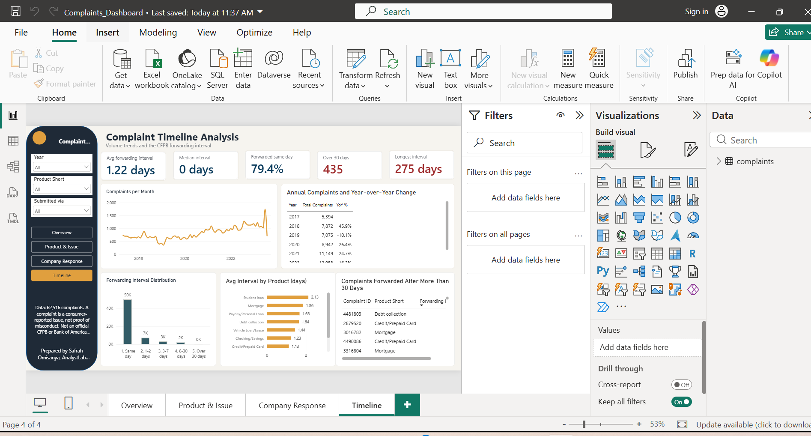
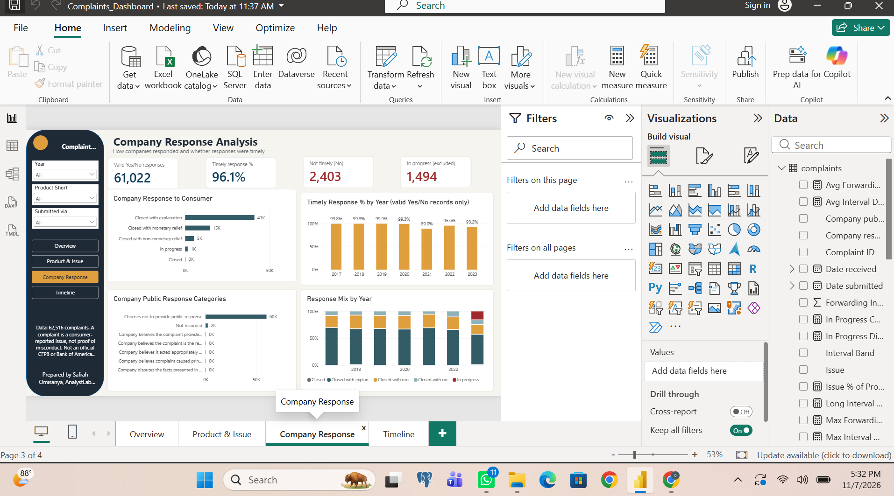
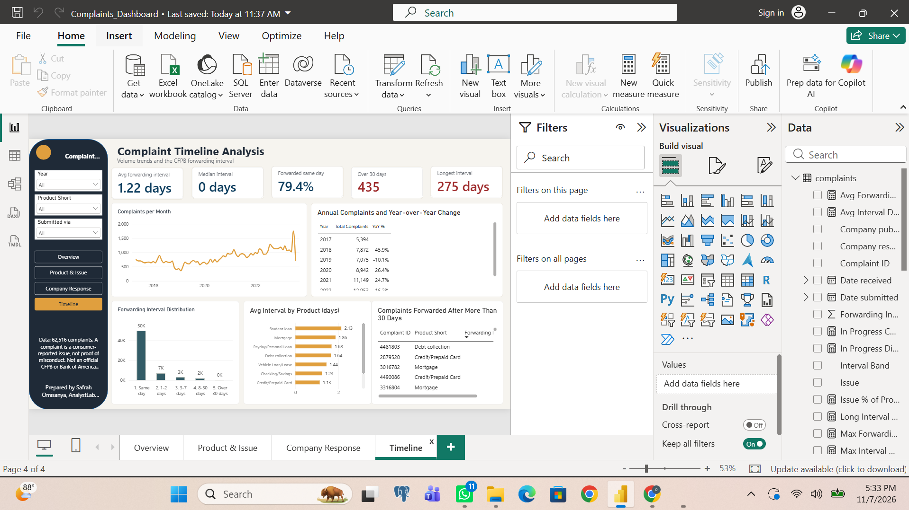
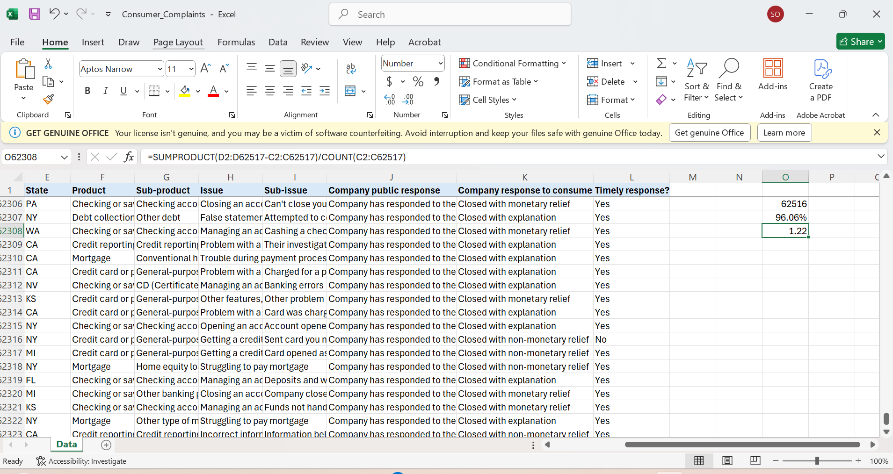

# Consumer Complaint Monitoring and Response Dashboard

AnalystLab Africa | Data Analytics Internship | Week 4
Prepared by Safrah Omisanya

## Project
A four-page Power BI dashboard on 62,516 Bank of America consumer complaints recorded by the CFPB (1 May 2017 to 28 Aug 2023). It shows complaint volumes, product and issue drivers, company responses, timely-response performance and the CFPB forwarding interval.

## Dashboard pages
1. Executive Overview: headline KPIs, monthly trend, product and annual volume, key takeaways
2. Product & Issue: products, sub-products, top issues, Product-by-Issue matrix, product share
3. Company Response: response mix, timely % by year, public response, response mix by year
4. Complaint Timeline: forwarding interval KPIs, monthly trend, year-over-year, interval bands, long-interval cases

Slicers for Year, Product and Submitted via apply on every page.
## Dashboard preview

## Validation evidence
Independent Excel check: 
Slicer tests: `screenshots/test1_year2021.png`, `test2_checking.png`, `test3_phone.png`
## Methodology
- Data inspection and cleaning in Power Query (no rows removed; source file never edited)
- 12 KPIs defined as DAX measures (see `KPI_Definition_Sheet.docx`)
- Independent checks in Excel and Python (see `Validation_Evidence.docx`, `verification_script.py`)
- Findings and recommendations in `Executive_Summary.docx`

## Tools
Power BI Desktop (Power Query, DAX), Excel, Python (pandas)

## Setup
1. Download `Consumer_Complaints.xlsx` (CFPB public data, sheet `Data`).
2. Open the `.pbix` and, if prompted, point the `complaints` query to your local copy (Home > Transform data > Data source settings).
3. Refresh.
4. To re-verify: `python3 -I verification_script.py Consumer_Complaints.xlsx`

## Key definitions and assumptions
- Complaint ID is the unique key; counts use DISTINCTCOUNT.
- Date submitted = received by CFPB; Date received = sent to company. Their difference is the **CFPB forwarding interval, not the company's response time**.
- Timely % = Yes / (Yes + No). Blank values are In progress complaints, excluded from the denominator and reported separately (1,494).
- Year and month are taken from Date submitted.
- "Unusually long" interval = more than 30 days (p99 = 25 days).

## Limitations
- 2017 and 2023 are partial years; 2023 is provisional because of 1,494 open complaints.
- A complaint is a consumer-reported issue, not proof of misconduct.
- A response category is not proof of satisfactory resolution.
- One company, no narratives, no customer or transaction base (counts are not rates).

## Contribution and collaboration
Individual work: data inspection, cleaning, DAX, dashboard design, validation, documentation. Integration notes: the monthly series and KPI definitions are ready for use by the Machine Learning track (forecasting) and the Generative AI track (natural-language questions).

## Revision log
| Date | Change | Reason |
|---|---|---|
| Nov 2026 | Text display measures for cards | Cards abbreviated 62,516 to 63k |
| Nov 2026 | Same-Day % formatted as percentage | Showed 0.79% instead of 79.4% |
| Nov 2026 | Timely-by-year sorted by Year; YoY totals off | Axis order and a meaningless total |

## Files
- Dashboard (.pbix): (https://drive.google.com/drive/folders/1HJ3BRhYDdTtHczFgNKCoCAat0NE8m30L?usp=drive_link)
- docs/: data-quality assessment, KPI definitions, validation evidence, executive summary, presentation script
- scripts/verification_script.py: Python recheck of the KPIs
- screenshots/: dashboard pages and validation evidence
